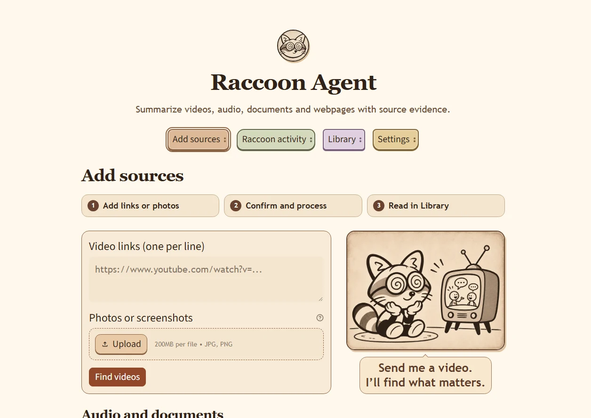
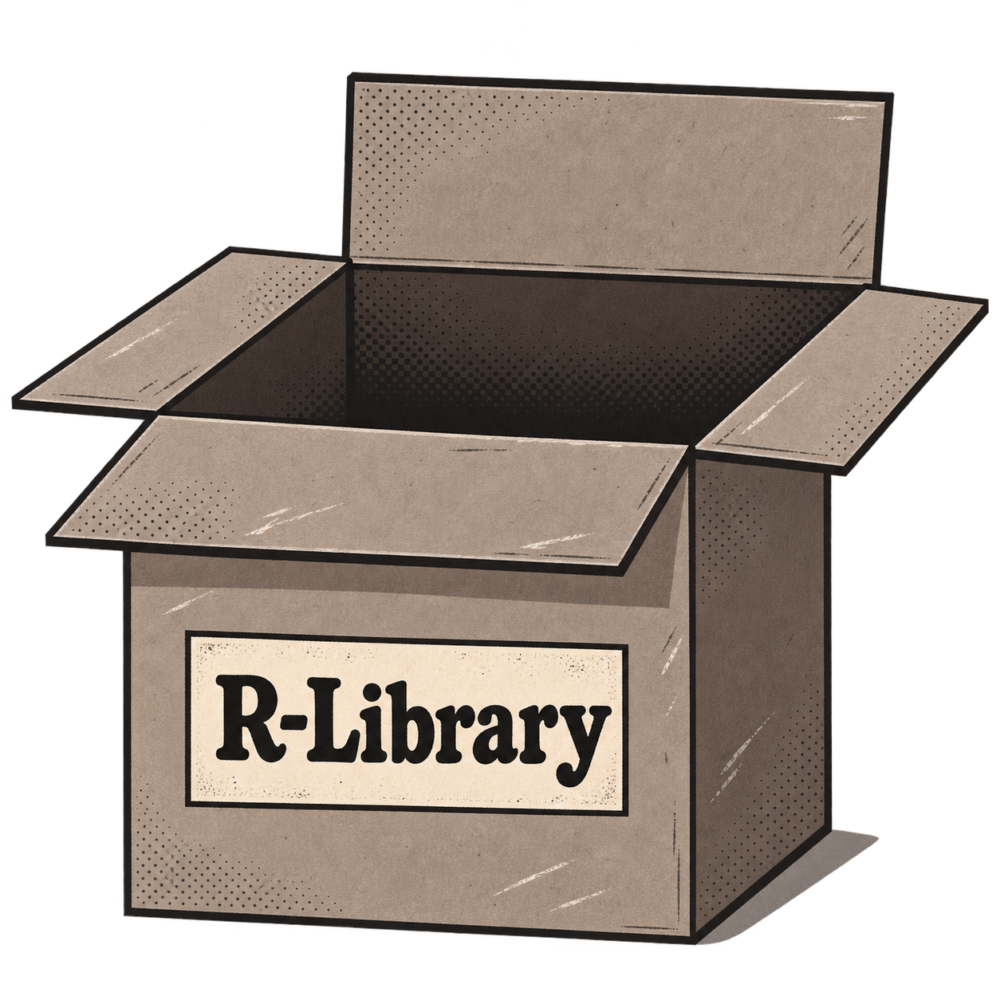

# Raccoon Agent

[English guide](raccoon/README.md) · [中文指南](raccoon/README.zh-CN.md) · [Changelog / 更新记录](raccoon/CHANGELOG.md)

Raccoon Agent turns videos, audio, documents, and webpages into searchable summaries with source evidence. Submit links or files from the web interface or drag them into the Raccoon Box desktop window.

Raccoon Agent 可以将视频、音频、文档和网页整理为带来源证据的摘要。可以在网页端添加链接或文件，也可以直接拖入桌面的 Raccoon Box。

