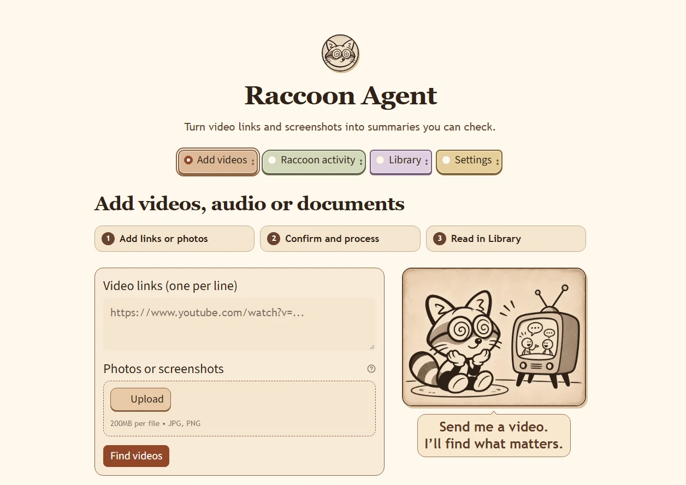

  

<h1 align="center">Raccoon Agent · 浣熊助手</h1>

把视频、音频、文档和网页整理成可核对的摘要。 
Summarize videos, audio, documents, and webpages with source evidence.

  <a href="personal_video_agent/README.zh-CN.md">中文使用指南</a> ·
  <a href="personal_video_agent/README.md">English guide</a> ·
  <a href="personal_video_agent/CHANGELOG.md">更新记录 / Changelog</a>

  

## 能做什么

| 来源 | 功能 |
| --- | --- |
| 视频链接、照片或截图 | 从截图识别视频并核对候选链接。优先读取字幕，缺少字幕时本地转录。 |
| 音频 | 批量上传 MP3、WAV 等文件，在本地转录并按所选语言生成摘要。 |
| PDF、Word、TXT、Markdown | 提取正文和表格，扫描页和内嵌图片可交给配置的 OCR。 |
| 公开网页和 PDF 链接 | 批量提取正文与表格，保留原始网址。 |

摘要按类别保存在本地 Library。点击摘要旁的小电视可打开对应证据。Raccoon activity 提供独立任务进度、失败原因和分步骤 API 用量。

## 如何使用

1. 下载项目并进入 `personal_video_agent`。按[中文使用指南](personal_video_agent/README.zh-CN.md)安装 Python、FFmpeg 和依赖，双击 **Start Raccoon Agent.cmd**。
2. 在 **Settings** 选择摘要语言和模型。可以使用本地 llama.cpp，或选择 API 供应商并填写 Key。
3. 在 **Add videos** 提交来源。视频链接或截图点击 **Find videos**，在 **Finding** 确认候选后点击 **Process video**。音频、文档和网页可直接送到 **Processing**。
4. 完成后到 **Library** 阅读摘要、展开原文并查看证据。

## 界面风格 / Interface

  

米色纸纹、深棕线条和圆角电视来自浣熊插画。导航用不同颜色标出导入、活动、资料库和设置。摘要旁的小电视同时是打开来源证据的按钮。

Warm paper tones, dark outlines, and rounded television shapes carry the illustrations into the interface. Color distinguishes the intake, activity, library, and settings pages. The small TV beside a summary point opens its source evidence.

## Features and quick start

- Find videos from links or screenshots, use available captions, or transcribe audio locally.
- Extract text and tables from documents and public webpages. Scan OCR uses the configured visual reader.
- Choose local llama.cpp or a custom summary API. Track jobs and API use in Raccoon activity, then review summaries and source evidence in Library.

Install the dependencies from the [English guide](personal_video_agent/README.md), then double-click **Start Raccoon Agent.cmd**. Choose your model and summary language in **Settings**, submit sources under **Add videos**, confirm video matches in **Finding**, and read the finished summaries in **Library**. The English and Chinese guides include module-by-module disk, RAM, and GPU requirements.
