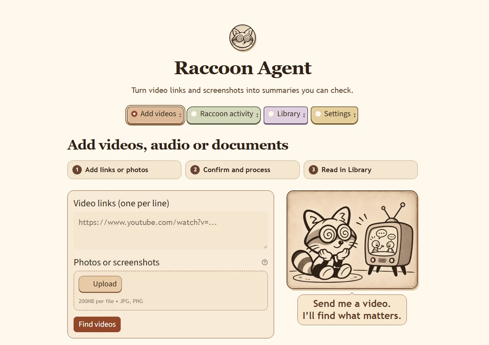

# Raccoon Agent 浣熊助手

[English](README.md) · [更新记录](CHANGELOG.md)

本地整理视频、音频、PDF、Word 和公开网页。摘要中的小电视可以打开对应的原文证据。

## 安装与启动

安装 64 位 Python 3.11+ 和 FFmpeg，在本目录运行以下命令。

```powershell
python -m venv .venv64
.\.venv64\Scripts\python.exe -m pip install -r requirements.txt
```

双击 **Start Raccoon Agent.cmd**。在 Settings 选择 API 供应商、填写 Key 并选模型，或运行本地模型安装脚本后选择 Local llama.cpp。

Local model / 本地模型: `powershell -ExecutionPolicy Bypass -File .\setup-local-llama.ps1`

## 使用步骤



- **视频链接和截图**。点击 **Find videos**，在 **Raccoon activity → Finding** 里确认已验证的候选，再点 **Process video**。有字幕时优先读取字幕，缺少字幕时使用本地语音转录。
- **音频和文档**。在 **Audio and documents** 批量选文件，点击 **Process uploaded files**。支持常见音频、PDF、DOCX、TXT 和 Markdown。文档读取会提取文字和表格，扫描页和内嵌图片可交给已配置的 OCR。
- **公开网页和 PDF**。在 **Webpages and PDF links** 每行输入一个网址，点击 **Process webpages**。
- **查阅结果**。在 **Processing** 看各任务进度，在 **Usage** 看分步骤 API 用量。完成后打开 **Library**，点击摘要旁的小电视查看来源证据。

## 模块容量与设备要求

基础环境、GGUF 和本地运行程序的磁盘占用为本机实测。其余模型缓存及 RAM、显存为规划参考，实际峰值随上下文、文件大小和并发变化。

| 模块 | 磁盘占用 | RAM / 显存 | 设备要求 |
|---|---|---|---|
| 界面、文档及网页提取 | 0.79 GiB | 8 GB RAM; 16 GB with local workers | Windows x64, Python 3.11+ |
| 视频和音频下载 | Several GB temporary / 临时文件数 GB | Depends on media size / 随文件大小变化 | FFmpeg, internet for URLs / 链接需联网 |
| Faster Whisper small 转录 | ~0.5 GB model / 模型 | 2–4 GB RAM or VRAM / 内存或显存 | CPU INT8 or NVIDIA CUDA 12 cuBLAS + cuDNN 9 |
| llama.cpp 本地摘要 | 1.27 GiB GGUF + 0.08 GiB runtime | 3–6 GB RAM or VRAM / 内存或显存 | CPU or compatible GPU / 兼容显卡 |
| RapidOCR 文字识别 | Included in base environment / 包含于基础环境 | 1–2 GB RAM | CPU |
| PaddleOCR-VL 表格与版面 | 1.04 GiB environment + model cache / 另加模型缓存 | 16 GB system RAM recommended / 建议整机 16 GB | Separate setup; compatible Paddle runtime for GPU / 独立安装，GPU 需兼容运行时 |
| 摘要、匹配及视觉 API | No local weights / 无本地权重 | No dedicated GPU / 无需独显 | Internet and API key / 联网及密钥 |

[Faster Whisper benchmarks](https://github.com/SYSTRAN/faster-whisper#benchmark) · [Qwen3 GGUF](https://huggingface.co/Qwen/Qwen3-1.7B-GGUF) · [PaddleOCR-VL](https://huggingface.co/PaddlePaddle/PaddleOCR-VL-1.6)

## 配置与数据

需要本地 PaddleOCR 时运行 `setup-local-vision.ps1`。从 `.env.example` 创建 `.env` 来配置照片识别及视觉接口。升级时保留 `data/` 和 `.env`。Settings 中输入的摘要 Key 重启后需重新填写。

公开网页支持正文和表格提取。扫描 PDF、内嵌图片使用配置的 OCR，复杂表格请核对证据。
